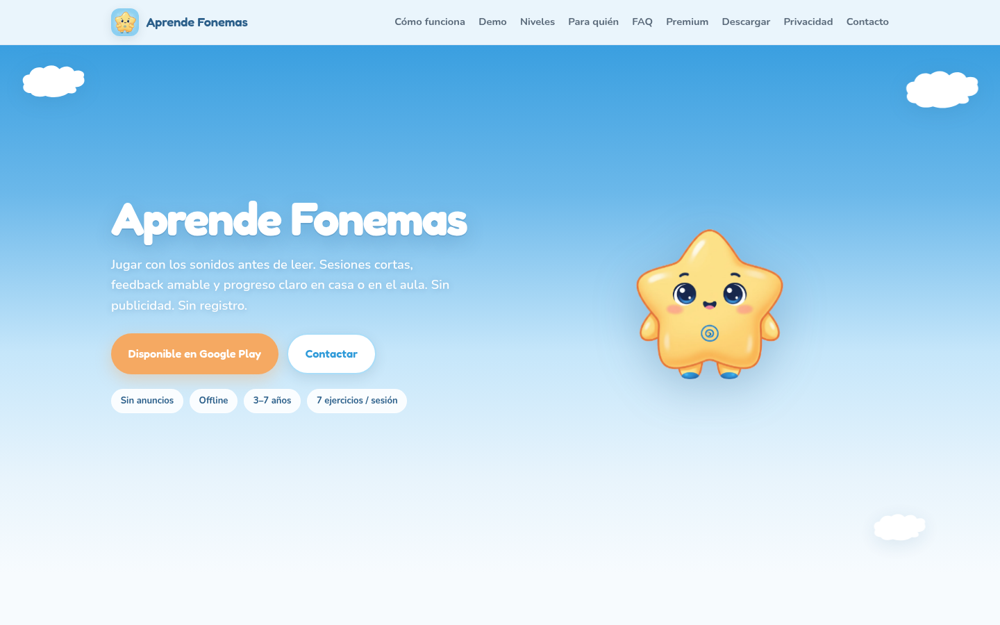
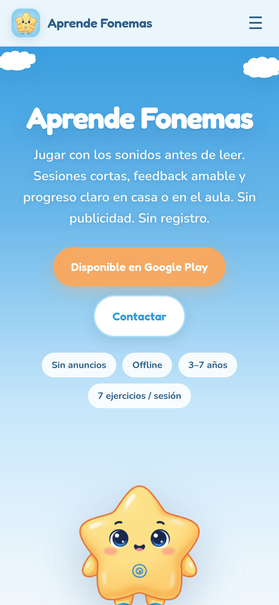

# Aprende Fonemas · Caso de estudio

Caso práctico sobre **Aprende Fonemas**, una app Android de conciencia fonológica para niños de 3 a 7 años, publicada en [Google Play](https://play.google.com/store/apps/details?id=com.davidspr81.aprendefonemas), con su web de producto en [aprendefonemas.netlify.app](https://aprendefonemas.netlify.app).

> **El código fuente es privado.** Este repositorio no contiene código, ilustraciones ni audios de la app. Documenta el producto y las decisiones técnicas que se tomaron para construirlo y publicarlo. Todos los datos que aparecen se pueden contrastar con la ficha de Google Play, la web o el repositorio privado.

---

## Contenido

1. [El producto](#el-producto)
2. [Punto de partida](#punto-de-partida)
3. [Enfoque pedagógico](#enfoque-pedagógico)
4. [Decisiones técnicas](#decisiones-técnicas)
5. [La web](#la-web)
6. [Stack](#stack)
7. [Resultados verificables](#resultados-verificables)
8. [Versión 1.1: que vuelvan](#versión-11-que-vuelvan)
9. [Lo aprendido](#lo-aprendido)
10. [Autor](#autor)

---

## El producto

Aprende Fonemas ayuda a niños de 3 a 7 años a trabajar la conciencia fonológica antes de leer: escuchar sonidos, relacionar letras e imágenes, contar sílabas, rimar, unir fonemas y leer primeras frases.

- **Para quién:** familias, docentes de educación infantil y logopedas (como apoyo lúdico, sin sustituir la intervención profesional).
- **Cómo se usa:** sesiones de unos 5 minutos (7 ejercicios), consignas habladas, tarjetas grandes y hasta 3 estrellas por nivel. Hay una pantalla de progreso pensada para el adulto.
- **Idioma:** español de España, con sus particularidades fonéticas: /θ/ (ceceo), B y V con el mismo sonido y H muda.
- **Modelo:** freemium. Niveles 1–4 gratis con 10 letras (A, E, I, O, U, P, M, L, S, T). Una compra única de 3,99 € desbloquea las 27 letras del abecedario (RAE) y los niveles 5–12. Sin suscripción y sin anuncios.

---

## Punto de partida

Las apps infantiles de lectura suelen compartir varios problemas:

- **Publicidad y compras insistentes** dentro de la experiencia del niño.
- **Registro de cuentas y datos en la nube**, algo delicado cuando el usuario es menor.
- **Necesidad de conexión** para jugar, lo que complica su uso en el aula.
- **Contenido pensado para otras variantes del español**, que no respeta la pronunciación peninsular.

El objetivo fue una app que funcione sin conexión, no recoja datos, tenga un precio claro y trabaje la fonología del español de España de forma progresiva.

---

## Enfoque pedagógico

Los 12 niveles van del sonido aislado a la frase, aumentando la dificultad paso a paso:

| Nivel | Ejercicio | Acceso |
|------:|-----------|--------|
| 1 | Escucha y elige la letra | Gratis |
| 2 | Escucha y elige el dibujo | Gratis |
| 3 | Escucha y elige la palabra | Gratis |
| 4 | ¿Con qué letra empieza? | Gratis |
| 5 | ¿Cuántas sílabas tiene? | Premium |
| 6 | ¿Con qué sílaba empieza? | Premium |
| 7 | ¿Con qué letra termina? | Premium |
| 8 | Palabras que riman | Premium |
| 9 | Junta los sonidos | Premium |
| 10 | ¿Qué letra falta al final? | Premium |
| 11 | ¿Qué letra falta en medio? | Premium |
| 12 | Lee la frase y elige el dibujo | Premium |

En resumen: primero se reconocen sonidos y letras (1–4), luego se trabaja la sílaba y la rima (5–8), después la fusión y la posición de los fonemas dentro de la palabra (9–11) y, al final, la lectura de frases sencillas (12). El mecanismo es siempre el mismo: **escucha, elige y gana estrellas**, así el niño no tiene que aprender reglas nuevas en cada nivel.

---

## Decisiones técnicas

### Offline y privacidad infantil

- Todo el contenido y el audio van dentro de la app: se juega sin conexión. Solo hace falta internet para comprar Premium.
- Sin registro, sin perfiles en la nube, sin publicidad y sin analítica. El progreso se guarda solo en el dispositivo.
- En la sección de seguridad de datos de Google Play figura «No se recogen datos» y «No se comparten datos con terceros».

### Compra única y control parental

- Un único producto de compra (`premium_unlock`), sin suscripciones, integrado con Google Play Billing.
- Antes de iniciar la compra aparece una **puerta para adultos**, para que el niño no llegue al pago por accidente.
- En la versión 1.0 la integración de pagos usaba `react-native-iap` 12 con un parche propio y un plugin de configuración de Expo para el permiso de facturación de Play. En la 1.1 se sustituye por `expo-iap` 6.1.1 (Google Play Billing 9.1), sin parches.
- La lógica de Premium y la distribución de las pantallas Premium tienen pruebas automatizadas propias.

### Cumplimiento de la Política de Familias de Google Play

- La ficha de Google Play muestra el **compromiso con el cumplimiento de la Política de Familias de Play**.
- Las decisiones anteriores (sin anuncios, sin datos, puerta para adultos) son las que hacen posible ese encaje en una app dirigida a menores.

### Calidad del contenido con tests

- Los tests con Jest no solo comprueban código: revisan la **calidad del contenido pedagógico** (que los ejercicios de cada nivel estén bien formados y sean coherentes con lo que pide el nivel).
- Hay además pruebas del núcleo de la app, del servicio de Premium, de la disposición de las pantallas Premium y de la migración del progreso guardado entre versiones, para que una actualización no borre los avances del niño.

### Audio

- La app se basa en escuchar antes de tocar: un botón grande reproduce el sonido, la palabra o la frase, y después el niño elige.
- Los fonemas aislados están pensados para el español de España (/θ/, B=V, H muda).
- Los audios y las ilustraciones son contenido propio del producto y no se publican.

### Builds y publicación

- Builds de Android generadas con **EAS Build** (Expo Application Services).
- Publicada en Google Play con soporte para móvil y tablet, en vertical y horizontal.
- Política de privacidad pública, enlazada desde la ficha de la tienda.

---

## La web

[aprendefonemas.netlify.app](https://aprendefonemas.netlify.app) es una web estática alojada en Netlify que:

- explica qué es la app, cómo funciona (escucha, elige, gana estrellas) y para quién es (familias, docentes, logopedas);
- muestra los 12 niveles y qué incluye Premium, con el precio claro;
- responde preguntas frecuentes (conexión, datos del niño, edad);
- aloja la [política de privacidad](https://aprendefonemas.netlify.app/privacidad.html) que exige Google Play;
- enlaza a la ficha de Google Play y al contacto, aprendefonemas@gmail.com.

---

## Stack

| Área | Tecnología |
|---|---|
| App | v1.0: React Native 0.81.5, React 19.1, Expo SDK 54 · v1.1: React Native 0.86.3 (Nueva Arquitectura), React 19.2, Expo SDK 57 |
| Plataforma | Android (móvil y tablet) |
| Audio | v1.0: `expo-av` · v1.1: `expo-audio` con caché local de los MP3 |
| Pagos | v1.0: Google Play Billing con `react-native-iap` 12 (parcheado) · v1.1: `expo-iap` 6.1.1 (Billing 9.1) |
| Recordatorio (v1.1) | Módulo nativo propio (Kotlin y Swift), notificación local, sin Firebase |
| Datos | Almacenamiento local en el dispositivo, sin backend |
| Calidad | Jest (tests de lógica y de contenido pedagógico; 928 tests en la v1.1) |
| Builds | EAS Build · R8 activado en la v1.1 |
| Web | HTML y CSS estáticos en Netlify |

---

## Resultados verificables

- **Publicada en Google Play** como app con compras integradas; última actualización de la ficha el 27 de agosto de 2026.
- **Seguridad de datos en Google Play:** no se recogen datos y no se comparten con terceros.
- **Compromiso con la Política de Familias de Play** visible en la ficha.
- **12 niveles** completos, 4 gratuitos y 8 Premium, con una compra única de 3,99 €.
- **Web de producto y política de privacidad** públicas en Netlify.
- **Batería de tests** con Jest que incluye la validación del contenido pedagógico.
- Según el historial de git, la versión pública de revisión del código se preparó el 10 de septiembre de 2026; el desarrollo anterior está en un repositorio privado.

---

## Versión 1.1: que vuelvan

> **Estado (octubre de 2026): en prueba cerrada en Google Play.** Todavía no hay datos de la versión 1.1 en producción.

### El problema, con datos

Datos de Play Console de los 90 días anteriores al 12 de octubre de 2026 (versión 1.0):

| Dato | Valor |
|---|---|
| Impresiones en la ficha | 2.240 |
| Instalaciones | 96 (50,86 % de quienes ven la ficha) |
| Primeras aperturas | 58 (**el 40 % instala y no abre la app**) |
| Usuarios activos al mes | 56 |
| Retención a 7 días | **1 dispositivo** |

La ficha convierte bien. Lo que falla es **la primera apertura** y, sobre todo, **la vuelta**: casi nadie juega una segunda semana.

### Decisiones

- **Retención antes que captación.** No tiene sentido pagar por instalaciones si los niños no vuelven. La 1.1 se centra en abrir la app, empezar rápido y volver al día siguiente.
- **Sin anuncios y sin datos, también ahora.** Nada de analítica ni de SDK de terceros para medir: las métricas salen solo de Play Console. La sección de seguridad de datos sigue en «no se recogen datos».
- **Recordatorio local sin Firebase.** Un aviso push habitual necesita Firebase Cloud Messaging y un servicio externo, que encaja mal con la Política de Familias y con «no se recogen datos». Se hizo un módulo nativo propio que programa el aviso en el propio móvil: sin servidores, sin internet y sin alarmas exactas. Es opcional, viene apagado y lo activa un adulto; los únicos permisos nuevos son `POST_NOTIFICATIONS` y `RECEIVE_BOOT_COMPLETED`.
- **Motivar sin castigar.** La racha se cuenta como «semana de la estrella»: un día sin jugar no muestra nada negativo.

### Lo implementado

- **Empezar con un toque:** Inicio con «Continuar · Nivel X», o «¡A repasar!» cuando no queda ningún nivel por hacer; pantalla de carga más corta.
- **Partida de hoy:** repaso corto de 7 retos que mezcla los niveles completados.
- **La semana de la estrella** (de lunes a domingo, en Progreso) y celebraciones a los 3, 5 y 7 días seguidos.
- **Tutorial nuevo** de 5 pasos con dibujos y **primer ejercicio guiado** con una mano que señala.
- **Guía para familias** en Ajustes y, al terminar una partida, una frase para el adulto con las letras practicadas.
- **Álbum de letras** en Progreso y **prueba gratis del nivel 5** (una partida) para mostrar qué incluye Premium.
- **Más variedad:** mezcla justa (Fisher-Yates) y memoria de lo ya visto de 30 elementos por nivel durante 7 días.
- **Petición de valoración** solo detrás de la puerta para adultos.
- **Técnica:** Expo SDK 57 y React Native 0.86 (Nueva Arquitectura), `expo-audio` con caché, `expo-iap` 6.1.1, R8, pantalla completa de Android 15 (edge-to-edge) y 928 tests.

### Métricas pendientes

Se medirán en Play Console cada 2 semanas tras publicar la 1.1 en producción. **Aún no hay resultados**:

- porcentaje de instalaciones que llegan a abrir la app (punto de partida: 58 de 96);
- retención a 1 y a 7 días (punto de partida a 7 días: 1 dispositivo);
- usuarios activos al mes;
- compras de Premium.

---

## Lo aprendido

- **La privacidad infantil se diseña desde el principio.** Sin cuentas, sin red y sin analítica, la seguridad de datos de la tienda queda en «no se recogen datos» sin tener que justificar excepciones.
- **Una compra de un solo pago también tiene complejidad.** Integrar Play Billing en Expo pidió un plugin de configuración y un parche de la librería, además de la puerta para adultos.
- **El contenido también se testea.** En una app educativa, un ejercicio mal formado es un fallo tan grave como un error de código; por eso hay tests que revisan los niveles.
- **Las actualizaciones no pueden borrar el progreso.** Migrar los datos guardados entre versiones es necesario aunque todo viva en el dispositivo.
- **La variante del idioma importa.** Respetar la fonética del español de España condiciona el audio y la elección de las palabras.
- **La web es parte del producto.** Explica el modelo con claridad y cumple el requisito de política de privacidad de la tienda.
- **Publicar no es el final.** Los datos de Play Console mostraron que el problema no era la ficha sino la vuelta; la 1.1 nace de ahí.
- **Respetar la privacidad también limita las herramientas.** Un recordatorio sin Firebase obligó a escribir un módulo nativo pequeño, pero mantiene la app sin datos y sin servicios externos.

---

## Autor

**David Pérez Rodríguez** · Full Stack Developer Junior

- Portfolio: [david-miportfolio.netlify.app](https://david-miportfolio.netlify.app/)
- LinkedIn: [perezrodriguezdavid](https://es.linkedin.com/in/perezrodriguezdavid)
- GitHub: [DavidsPR81](https://github.com/DavidsPR81)
- Contacto de la app: [aprendefonemas@gmail.com](mailto:aprendefonemas@gmail.com)

© Aprende Fonemas. Documentación publicada con fines de portfolio; el código, los audios y las ilustraciones del proyecto no se distribuyen.
